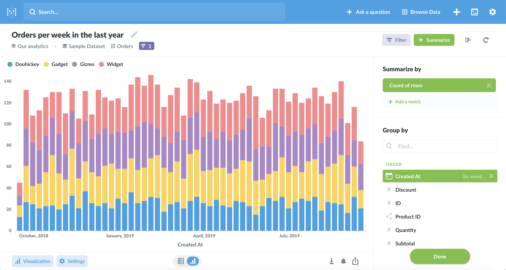

# Metabase
* 安装：
	```javascript
		brew依赖git：
			sudo yum install git
		brew non-interactive mode 安装: https://github.com/Homebrew/install/issues/612
			CI=1 /bin/bash -c "$(curl -fsSL https://raw.githubusercontent.com/Homebrew/install/HEAD/install.sh)"
				- Run these three commands in your terminal to add Homebrew to your PATH:
					echo '# Set PATH, MANPATH, etc., for Homebrew.' >> /home/ec2-user/.bash_profile
					echo 'eval "$(/home/linuxbrew/.linuxbrew/bin/brew shellenv)"' >> /home/ec2-user/.bash_profile
					eval "$(/home/linuxbrew/.linuxbrew/bin/brew shellenv)"
				- Install Homebrew's dependencies if you have sudo access:
					sudo yum groupinstall 'Development Tools'
				For more information, see:
					https://docs.brew.sh/Homebrew-on-Linux
				- We recommend that you install GCC:
					brew install gcc
				- Run brew help to get started
				- Further documentation:
					https://docs.brew.sh
		brew 安装clojure：
			brew install clojure
		安装yarn:
			nvm use v16.19.0
			npm install --global yarn
			yarn
			如果yarn一直不动或者出错，试着清理yarn cache
			yarn cache clean && yarn
	```

* 运行：
	```javascript
        本地模拟数据使用json-server 
        A：代码中加入json-server域名 helpful-teal-tam.cyclic.app
        B: 用nginx的location解决跨域问题并把域名转发到json-server的端口的mock api去
			sudo yum install nginx
			nginx.conf:
				listen       3002;
				listen       [::]:3002;
				location / {
					include /etc/nginx/conf.d/proxy.info;
					proxy_pass http://127.0.0.1:3000/;
				}
				location /api/ {
					include /etc/nginx/conf.d/proxy.info;
					proxy_pass https://helpful-teal-tam.cyclic.app/;
				}
			proxy.info:
				# 不需要重写 location 头
				proxy_redirect off;

				# 设置 Host 头
				proxy_set_header Host $host;
				# 设置客户端真实 IP 地址：X-Real-IP
				proxy_set_header X-Real-IP $remote_addr;
				# 设置客户端真实 IP 地址 + 每一层级的代理 IP
				proxy_set_header X-Forwarded-For $proxy_add_x_forwarded_for;
				# 设置http版本
				proxy_http_version 1.1;
				proxy_set_header Connection "keep-alive";
                sudo nginx
            访问 http://localhost:3002
		前端：
			yarn build
		后端：
			clojure -M:run

			【报错]:Error building classpath. The following libs must be prepared before use: [metabase/java-deps]
			 解决方法：clj -X:deps prep / clojure -X:deps prep
		访问 http://localhost:3000
	```
    
Metabase is the easy, open source way for everyone in your company to ask questions and learn from data.



[](https://github.com/metabase/metabase/releases)
[](https://circleci.com/gh/metabase/metabase)
[](https://codecov.io/gh/metabase/metabase)

# Features

- 5 minute [setup](https://metabase.com/docs/latest/setting-up-metabase.html) (We're not kidding)
- Let anyone on your team [ask questions](https://metabase.com/docs/latest/users-guide/04-asking-questions.html) without knowing SQL
- Rich beautiful [dashboards](https://metabase.com/docs/latest/users-guide/06-sharing-answers.html) with auto refresh and fullscreen
- [SQL Mode](https://www.metabase.com/docs/latest/users-guide/writing-sql.html) for analysts and data pros
- Create canonical [segments and metrics](https://metabase.com/docs/latest/administration-guide/07-segments-and-metrics.html) for your team to use
- Send data to Slack or email on a schedule with [dashboard subscriptions](https://www.metabase.com/docs/latest/users-guide/dashboard-subscriptions.html)
- View data in Slack anytime with [MetaBot](https://metabase.com/docs/latest/users-guide/11-metabot.html)
- [Humanize data](https://metabase.com/docs/latest/administration-guide/03-metadata-editing.html) for your team by renaming, annotating and hiding fields
- See changes in your data with [alerts](https://www.metabase.com/docs/latest/users-guide/15-alerts.html)

For more information check out [metabase.com](https://metabase.com/)

## Supported databases

- [Officially supported databases](https://www.metabase.com/docs/latest/administration-guide/01-managing-databases.html#officially-supported-databases).
- [Community-supported drivers](https://www.metabase.com/docs/latest/developers-guide-drivers.html#how-to-use-a-community-built-driver).

## Installation

Metabase can be run just about anywhere so checkout our [Installation Guides](https://www.metabase.com/docs/latest/operations-guide/installing-metabase.html) for detailed instructions for various deployments. Here's the TLDR:

### Docker

To run Metabase via Docker, just type

```
docker run -d -p 3000:3000 --name metabase metabase/metabase
```

### JAR file

To run Metabase via a JAR file, you will need to have a Java Runtime Environment installed on your system.

We recommend the latest LTS version of JRE from [AdoptOpenJDK](https://adoptopenjdk.net/releases.html) with HotSpot JVM and x64 architecture, but other [Java versions](https://www.metabase.com/docs/latest/operations-guide/java-versions.html) might work too.

Go to the [Metabase download page](https://metabase.com/start/jar.html) and download the latest release. Place the downloaded JAR file into a newly created directory (as it will create some files when it is run), and run it with the following command:

```
java -jar metabase.jar
```

Now, open a browser and go to [http://localhost:3000](http://localhost:3000) , and you will be asked a set of questions that will set up a user account, and then you can add a database connection. For this to work you will need to get some information about which database you want to connect to, such as the Host Name and Port that it is running on, the Database Name and the User and Password that you will be using.

Once you have added this connection, you will be taken into the app and you'll be ready to ask your first question.

For a more detailed walkthrough, check out our [Getting Started](https://www.metabase.com/docs/latest/getting-started.html) guide.

# Frequently Asked Questions

Some questions come up over and over again. Check here first:
[FAQ](https://www.metabase.com/docs/latest/faq/start.html)

# Security Disclosure

See [SECURITY.md](./SECURITY.md) for details.

# Contributing

To get started with a development installation of the Metabase, follow the instructions at our [Developers Guide](https://www.metabase.com/docs/latest/developers-guide.html).

Then take a look at our [Contribution Guide](https://www.metabase.com/docs/latest/contributing.html) for information about our process and where you can fit in!

# Internationalization

We want Metabase to be available in as many languages as possible. See which translations are available and help contribute to internationalization using our project over at [POEditor](https://poeditor.com/join/project/ynjQmwSsGh). You can also check out our [policies on translations](https://www.metabase.com/docs/latest/faq/general/what-languages-can-be-used-with-metabase.html).

# Extending and Deep Integrations

Metabase also allows you to hit our Query API directly from Javascript to integrate the simple analytics we provide with your own application or third party services to do things like:

- Build moderation interfaces
- Export subsets of your users to third party marketing automation software
- Provide a specialized customer lookup application for the people in your company


# License

This repository contains the source code for both the Open Source edition of Metabase, released under the AGPL, as well as the commercial edition of Metabase Enterprise, released under the Metabase Commercial Software License. 

See [LICENSE.txt](./LICENSE.txt) for details.

Unless otherwise noted, all files © 2021 Metabase, Inc.
